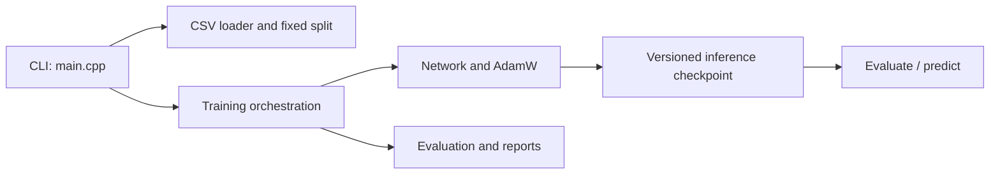

# Architecture and correctness

The project implements a dense classifier and its training algorithm directly in
C++17. It has no tensor library, automatic differentiation engine, or ML framework
at runtime. Python utilities use only the standard library.

## Boundaries

| Component | Responsibility |
| --- | --- |
| `include/mlp/network.h`, `src/network.cpp` | Dense layers, initialization, forward/backward passes, dropout, optimizer state, serialization |
| `include/mlp/data.h`, `src/data.cpp` | Strict CSV parsing, normalization, dataset invariants, stratified splitting |
| `include/mlp/trainer.h`, `src/trainer.cpp` | Mini-batches, shuffling, early stopping, checkpoint selection, metrics and run artifacts |
| `src/main.cpp` | CLI parsing, command dispatch and readable errors |
| `scripts/prepare_data.py` | Verified official IDX download, conversion, data provenance |
| `scripts/benchmark.py` | Controlled comparison with source/binary/checkpoint fingerprints |
| `evaluator/evaluate.py` | Independent evaluation of exported class predictions |

Each `Network` owns its parameters, gradients, optimizer moments and random-number
generator. There are no global model arrays. Parameters use double precision;
input pixels use floats to reduce dataset memory. Weight matrices are contiguous,
output-major arrays. Execution is single-threaded CPU code. A network instance is
not designed for concurrent training calls.

## Model

Default: **784 → 128 → 64 → 10**, with 109,386 trainable parameters.

Each hidden layer applies a dense transform, ReLU, and inverted dropout (default
probability 0.1). Hidden weights are sampled from a zero-mean normal distribution
with variance `2 / fan_in`; output weights use variance `2 / (fan_in + fan_out)`.
Biases start at zero. The output layer is linear; softmax converts its logits into
class probabilities only when needed.

Cross-entropy is computed as `max(logits) - logits[label] + log(sum(exp(logits - max)))`.
This remains meaningful when a wrong class has nearly all probability mass, rather
than clipping the loss at an arbitrary epsilon. The output derivative is
`softmax(logits) - one_hot(label)`. Hidden gradients include both the ReLU derivative
and the exact dropout mask/scaling used in the forward pass. Evaluation disables
dropout and does not advance the model RNG.

`--hidden none --dropout 0` uses the same implementation as a multinomial logistic
regression baseline. Hidden dimensions can be changed without recompilation.

## Optimization and validation

1. Normalize integer pixels by 255 using a fixed transform with no fitted statistics.
2. Create one seeded, stratified split of the training CSV. With official data and
   the default fraction, this yields 54,000 training and 6,000 validation samples.
3. Shuffle only training indices at each epoch. Persist both split memberships.
4. Accumulate gradients over the entire mini-batch, then average by its actual
   size. The last partial batch is included.
5. Optionally clip the **global norm of the averaged gradient** (default 5).
6. Apply AdamW with persistent moments and step-based bias correction. Weight
   decay is decoupled from the gradient update and excludes biases.
7. Select checkpoints by lowest validation cross-entropy. Stop after `patience`
   consecutive epochs without improvement, or the maximum epoch count.
8. Restore the best weights, and evaluate the test CSV through a separate command.

Train loss is the average of training-mode losses observed throughout an epoch,
with dropout active and parameters changing between batches. Validation loss is
computed once at epoch end with dropout disabled. They are not directly equivalent
measurements of the same model state.

A seed fixes initialization, dropout, splitting and shuffling on the same binary
and platform. C++ random distribution implementations and floating-point behavior
can vary across toolchains; cross-platform bit-for-bit identity is not promised.

## Artifacts and contracts

A training run refuses to overwrite a nonempty output directory. It writes:

- `config.json`: architecture, seed, optimizer settings and preprocessing rule.
- `train_indices.csv`, `validation_indices.csv`: zero-based input-row memberships.
- `history.csv`: epoch losses, validation accuracy/F1, and wall time.
- `best.mlp`: versioned, full-precision text checkpoint selected by validation loss.
- `validation_metrics.json`: metrics for that checkpoint.
- `summary.json`: best epoch, epochs completed and selection criterion.

Checkpoint version 1 stores architecture, dropout probability and parameters. It
supports inference through the same `/255` CSV preprocessing contract. It does
**not** store optimizer moments, random state or training position; it is not a
training-resumption format. `set_parameters()` also resets optimizer state.

Metrics include accuracy, macro F1, per-class precision/recall/F1, and a confusion
matrix with **actual classes as rows and predicted classes as columns**. Undefined
precision, recall and F1 use zero. Macro F1 averages across every configured class.

The CSV reader rejects missing files, empty datasets, Git LFS pointer files,
non-integer/out-of-range pixels, wrong row widths, invalid labels and count
mismatches. Checkpoints reject unsupported versions, invalid architecture sizes,
non-finite parameters, truncation and trailing data. Models are limited to 10M
parameters to prevent accidental excessive allocations.

## Verification and limitations

Numerical tests compare analytical gradients against central finite differences,
including dropout with a fixed mask. They check stable extreme-logit losses,
AdamW's first two updates, bias decay exclusion, batch averaging, checkpoint round
trips, strict input handling, split disjointness, partial batches, early stopping,
and learning a nonlinear XOR problem. CLI tests train twice and compare artifacts,
then compare predictions from reloaded checkpoints. Tests use synthetic data, so
CI needs no network or Git LFS download. Debug CI enables AddressSanitizer and
UndefinedBehaviorSanitizer.

This is an educational ML systems project, not a production inference service.
It loads CSV data into memory, has no GPU/BLAS acceleration, no resumable training,
no augmentation, and no convolutional layers. Flattening images discards explicit
spatial structure. A single-seed benchmark measures that run, not uncertainty or
statistical significance; use the multi-seed runner before making broader claims.

## References

- [Fashion-MNIST and official archive checksums](https://github.com/zalandoresearch/fashion-mnist)
- [He et al., initialization for rectifiers](https://arxiv.org/abs/1502.01852)
- [Loshchilov and Hutter, decoupled weight decay](https://arxiv.org/abs/1711.05101)
